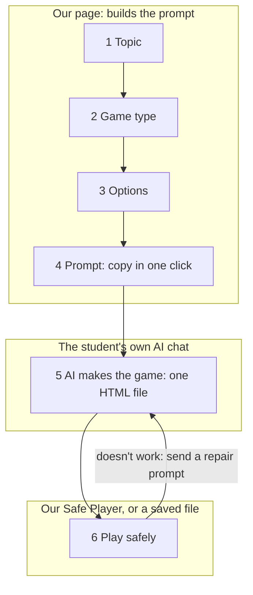

# Mängulabor (Game Lab): plan and requirements

Date of this version: 17 November 2026. Status: plan approved for version 1; no code written yet.

## Summary

Mängulabor is a web page, in Estonian and English, that turns a university student's topic and a few choices into a ready-to-paste prompt. Any AI chat then writes a study game as one HTML file. The site is static and hosted on GitHub Pages. Learning-science rules and safety rules are built into every prompt, and a "Safe Player" page runs the finished game in a sandbox.

Similar prompt tools exist, but those found cover quizzes only, are fixed text templates, or run inside a closed platform (see [existing-tools.md](existing-tools.md)). None found combines a game catalogue, Estonian, evidence-based study rules and safe running. The search was mainly in English, so an Estonian tool may exist that was missed.

The target group is university students, mostly adults, with no programming background. Version 1 offers six game types, with more advanced ones (such as platformers) later.

## Student flow

Our page handles four steps and ends with a prompt. The game itself is written by the student's own AI chat and then played in the Safe Player or from a saved file.



What each screen does:

1. **Topic.** One text box and a study-level choice.
2. **Game type.** Cards with the name, a one-line description and what the game trains; the student ticks one, or up to three to mix them (F31). Types that suit the chosen subject are marked as recommended.
3. **Options.** Five main choices, with the rest folded under "More options".
4. **Prompt.** A readable preview with each block labelled, one Copy button, and a short guide to what happens next.
5. and 6. **Play.** The student pastes the prompt into an AI chat, pastes the reply into the Safe Player, and plays. A menu of follow-up prompts covers repair, harder, easier, more items and fact-check.

Only step 4 produces something new on our page. If the game does not work, the repair prompt sends the student back to the AI chat.

Details: [game catalogue and options](game-catalogue-and-options.md), [prompt design](prompt-design.md), [safety](safety.md).

## Technical approach and GitHub Pages

The site is plain HTML, CSS and JavaScript files with no build tools, framework or server, so GitHub Pages can serve it as it is. The planned layout:

```text
index.html        the prompt builder
player.html       the Safe Player
css/styles.css    look and layout
js/app.js         screens and steps
js/prompt.js      assembles the prompt
js/player.js      scan, sandbox and storage bridge
data/games.js     game catalogue, options, prompt rules
i18n/et.js        all Estonian text
i18n/en.js        all English text
README.md         how to update the site (Estonian and English)
```

Choices and reasons:

- **No framework.** Nothing to install or keep updated, a very small download, and no third-party code on the page.
- **Language files as `.js`, not JSON.** Browsers commonly block a page opened from a downloaded folder from reading JSON files, but they load scripts, so the site also works offline and before it is published.
- **Content apart from code.** Games, options, rules and all wording sit in the data and language files, so a new game is a new entry plus a prompt module.
- **System fonts and inline icons only,** so the page makes no request to other sites.
- **Browsers.** Current versions of Chrome, Edge, Firefox and Safari, on phones and laptops.

**Publishing.** Upload the folder to this repository, switch on GitHub Pages in the repository settings, and open the address, which has the form `account.github.io/repository/`. Free GitHub Pages normally needs a public repository; GitHub's current rules are to be confirmed before publishing.

**Language.** The page language defaults to the browser language (Estonian if the browser is set to Estonian, otherwise English), with a visible switch; the choice is remembered in the browser. The language of the game is chosen separately. The instructions sent to the AI follow the page language. Every Estonian text needs review by a native speaker. See [prompt-design.md](prompt-design.md) for the Estonian quality risk.

**How the work is checked.** Headless-browser tests at phone and laptop widths in both languages; a test that every combination of game and options produces a prompt containing the full rule block; keyboard tests; and deliberately bad pages fed to the Safe Player (network request, pop-up, cookie access, redirect) to confirm each is blocked. Trials with other chat AIs need a person with access to them.

## Requirements

Requirement numbers are stable identifiers, so they are not contiguous.

### Must (version 1)

- **F1** The student enters a topic and picks a study level; the topic is required.
- **F2** The student picks one of six game types from cards that show the name, a one-line description and what it trains.
- **F3** The main screen offers difficulty and number of levels; all other options sit under "More options" with the defaults in [game-catalogue-and-options.md](game-catalogue-and-options.md).
- **F4** The page builds the prompt live, shows a preview, and copies it with one click and a visible confirmation.
- **F5** Every prompt contains the learning rules, content rules, technical and safety rules, and output format from [prompt-design.md](prompt-design.md), and asks for questions in one readable data block.
- **F6** The language of the game is chosen separately from the page language.
- **F7** The whole page is available in Estonian and English, with a visible language switch and a browser-based default.
- **F8** After copying, a short guide explains how to paste into an AI chat, save the result as an `.html` file or play it in the Safe Player, and check three answers against a textbook.
- **F9** Follow-up prompts: repair, harder or easier, more items, fact-check, translate, explain my mistakes.
- **F10** The Safe Player runs pasted games in a locked frame, strips markdown fences, and shows warnings for risky code. Confirmed for version 1, at least for the first testing.
- **F11** Short "why does the prompt say this?" explanations for each prompt block.
- **F28** Answer options are shuffled in code each time a question is shown, so the correct answer has no fixed position (a problem seen in students' earlier games). The prompt requires this, and the quality gate tests it.
- **F29** Readable contrast: text colour and background set explicitly, at least 4.5:1 for normal text and 3:1 for large text and controls, and right or wrong never shown by colour alone. The prompt requires this, and the quality gate measures it.
- **F21** Progress saving: games remember which items are mastered, on this device only, with a reset button.
- **F22** Scoreboard option in the builder: a top-ten list on this device with an optional nickname.
- **F23** The Safe Player's storage bridge, so progress and scores work inside the sandbox.
- **F25** Source mode: the student can paste notes as plain text, and the prompt then restricts questions to that text.
- **F26** For longer material, the page shows steps for attaching a file in the AI chat, and the prompt then refers to the attached file.
- **F27** A copyright and privacy notice appears whenever source mode is used: use only material you own, may share with AI tools, or that is openly licensed; no confidential material or personal data; follow your institution's rules. This is general guidance, not legal advice, and its wording needs review.

- **F31** Mixing game types: the student can tick one to three of the six version 1 games and combine them in one game (one HTML file, shared progress and scoreboard). Two ways to combine: every level has a round of each game, or each level uses one game, taking turns. At most three, because one file with more games gets large and error-prone. Action-style games (platformer, escape puzzle) are not mixable.
- **F32** The "More options" control is a large, clearly labelled button that lists what is inside (added after the owner missed it).
- **F30** Feedback and feature requests through GitHub issues. A "Feedback" link opens a prefilled new-issue page in the project's repository (in a new tab), using issue forms with Estonian and English wording. The page sends nothing by itself and shows a public-post warning first; the student needs a GitHub account to submit. See [decisions.md](decisions.md).

### Should (version 1.1 or 2)

- **F13** Teacher links: a link that opens the builder with chosen options already set.
- **F14** A suggested review rhythm shown after play, for example replaying over several days.
- **F15** The six version 2 games from the catalogue.
- **F16** Save the prompt as a text file.

### Could (later)

- **F17** Escape Puzzle, Concept Map and more advanced games such as platformers, each tested against the cognitive-load rule (see [learning-science.md](learning-science.md)).
- **F18** A third page language, for example Russian.
- **F19** Installable offline use as a web app.
- **F20** A small gallery of teacher-reviewed example games.
- **F24** The footer credits Haapsalu College, and the page shows a short licence notice that points to the `LICENSE` file (paid licence, see [decisions.md](decisions.md)). The licensor's name and contact must be filled in first.

### Quality requirements

- **Q1** No backend, accounts, cookies, analytics or requests to other sites. A plain link the student chooses to click (such as the feedback link) is not a request made by the page.
- **Q2** Works on current Chrome, Edge, Firefox and Safari, on phones and laptops.
- **Q3** Keyboard operable, readable contrast and labelled controls, aiming for WCAG 2.1 level AA.
- **Q4** Small and fast: system fonts, inline icons, no images from outside. A page-weight budget is set in phase 2.
- **Q5** All wording and game definitions live in data and language files that can be edited without coding.
- **Q6** Every game module passes the quality gate in [prompt-design.md](prompt-design.md) before release, including the automatic answer-order and contrast checks.

### Out of scope for now

- Calling an AI service from the page, which would need keys, costs and student data handling.
- Accounts, saved student results on a server, and leaderboards across users.
- Hosting the games students create.

## Build phases

The work starts with the prompts, because the whole app is only as good as the games they produce. Each phase ends with something that can be opened and reviewed before the next begins.

1. **Approval.** All ten planning questions are settled (see [decisions.md](decisions.md)).
2. **Phase 1, prompt lab (in progress: prompts and checker written; trial runs still to do; see [`prompts/`](../prompts/README.md)).** Write the shared rule block and the six game prompts, then trial them in both languages, with automatic checks for answer order and contrast. The pass mark is agreed first; the proposal is that at least 9 of 10 runs open, play without edits and contain no outside links. Output: the prompts and a results table.
3. **Phase 2, builder page (test version already built: topic, level, game cards, options, source mode with notice, live prompt preview, copy button, Estonian/English switch, feedback link; still to do: "why does the prompt say this?" explanations, follow-up prompts, polish and accessibility review).** Screens, options including progress saving, the scoreboard and source mode with its copyright notice, live prompt, copy button, language switch, and the Estonian and English text. Output: a working page to click through.
4. **Phase 3, Safe Player.** Paste, scan, sandbox and the storage bridge for progress and scores, plus the student guidance and the follow-up prompts.
5. **Phase 4, testing and pilot.** Browser, phone, keyboard and accessibility checks, then a small pilot with a few students and a teacher, and fixes from what they find.
6. **Phase 5, publishing.** The upload folder, a README in both languages, and GitHub Pages switched on.
7. **Later.** Version 2 items from the Should list.
